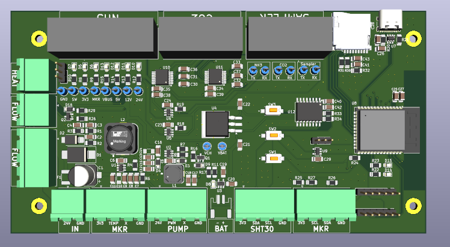

### This directory contains the KiCad design files, schematic documentation, and manufacturing files for 2 layer-PCB developed for **Milvus Consulting**.

---

## Repository Contents

* `schematic_kicad.pdf` This contains all the 7 hierarcy pages of the schematic
* KiCad Project
* `gerbers/` Manufacturing and assembly files (Gerber, Drill)
---

## Hardware Architecture

The board is built around an **ESP32-S3** microcontroller and is powered by a **24V DC** supply with a rechargable battery backup, dual switched 3.3V rails, and industrial sensor interfaces.

### 1. Power IN (`Power_in.kicad_sch`)
* **Input:** 24V DC via screw terminal (`J1`).
* **Protection:** Resettable fuse (`F1`, `SMD1812B200TF/30`), reverse-polarity Schottky diode (`D1`, `SS34`), and transient voltage suppressor (`D2`, `SMBJ28A`).
* **Voltage Monitoring:** 100kΩ / 10kΩ voltage divider (`VIN_SENSE`) to (`IO1`).

### 2. Power Rails & Battery Management (`Power_rails.kicad_sch`)
* **24V → 12V Buck Converter:** `TPS542021DDCR` (`U1`) for the heater and auxiliary power.
* **12V → 5V Buck Converter:** `MCP16301` (`U2`) for the flow sensor and battery charging path.
* **USB / 5V Power Path & LiPo Backup:** Automatic switching between `VBUS` and `+5V` (`Q1`, `D6`) feeding an `MCP73831-2-OT` (`U3`) charger for a single-cell LiPo battery (`BT1`, `802035`).
* **3.3V ULTRA LOW DROPOUT!:** `MCP1826S-3302E/EB` (`U4`) regulating `VBAT` to the main `+3.3V` rail. With minimal dropout so our single-cell LiPo battery gets used to it's maximum capacity! 
* **Switched Power Rails:** Two `TPS22918DBVR` load switches (`U5`, `U6`) allow the MCU shut down the Arduino MKR NB (`+3.3V_MKR`) and sensors(`+3.3V_SW`) independently. This is to save power whenever the 24V may be lost and that the battery life can get extended.
* **Diagnostics:** Dedicated Power LEDs (`D7`–`D13`) for all 7 rails (`+24V`, `+12V`, `+5V`, `VBUS`, `+3.3V`, `+3.3V_MKR`, `+3.3V_SW`).

### 3. Microcontroller & Reliability (`MCU.kicad_sch`)
* **MCU:** `ESP32-S3-WROOM-1` (`U8`) with native USB-C programming/debugging (`J4`) and ESD protection (`U7`, `USBLC6-2SC6`).
* **Hardware Watchdog:** External `TPS3823-33DBV` (`U9`) tied to `EN`, with a manual reset button (`SW2`) and disable jumper (`J5`, `JP_WDT`) for flashing/debug options.
* **Status & Expansion:** Boot button (`SW1`), Status LED (`D15`, green), Error LED (`D14`, red), backup UART programming header (`J6`), and GPIO/I2C expansion header (`J7`).

### 4. Serial RS232 Sensors (`Sensor_serial.kicad_sch`)
* Two `MAX3232` transceivers (`U10`, `U11`) powered by `+3.3V_SW` convert 3.3V UART signals to RS232 levels:
  * **NH3 Sensor (`J8`):** DB15 connector with `+24V` supply.
  * **CO2 Sensor (`J9`):** D-SUB 9 connector with `+24V` supply.
  * **Sampler (`J10`):** Standard RS232 D-SUB 9 connector.

### 5. Analog/I2C Sensors & Actuators (`Sensor_analog&actuators.kicad_sch`)
* **Cellular/Connectivity (`J13`):** Arduino MKR NB interface on `+3.3V_MKR` using a dedicated fast I2C bus (`I2C_FAST`).
* **Heater Driver (`J14`):** 12V low-side PWM switch (`Q2`, `AO3400A`) with flyback diode (`D16`, `PMEG2010ER`).
* **Air Pump (`J12`):** `+24V` supply with PWM control (`PUMP_PWM`).
* **Environmental & Flow Sensors:** External temperature/humidity sensor (`J11`), flow sensor (`J15`/`J17` with `+5V` and `I2C_SLOW`), and internal case temperature sensor (`J16`, analog).

### 6. Storage & Real-Time Clock (`Storage_RTC.kicad_sch`)
* **RTC:** `DS3231M` (`U12`) on `I2C_SLOW`, backed up by `VBAT` with manual reset switch (`SW3`).
* **Local Logging:** MicroSD card slot (`J18`, `MSD-1-A`) on SPI with card-detect (`SD_DET`) and `+3.3V_SW` power rail.

---

## ESP32-S3 Pinout Summary

| Function | Net Name | ESP32-S3 Pin | Notes |
| :--- | :--- | :--- | :--- |
| **Input Voltage Sense** | `VIN_SENSE` | `IO1` | 24V divider (100k / 10k) |
| **Case Temperature** | `TEMP_CASE` | `IO2` | Analog input (`J16`) |
| **Heater Control** | `HEATER_PWM` | `IO4` | 12V MOSFET (`Q2`) |
| **Slow I2C Bus** | `I2C_SLOW_SCL` / `SDA` | `IO5` / `IO6` | RTC, Flow, Ext. Temp/Hum, `J7` |
| **MKR NB Power Enable** | `3V3_MKR_ON` | `IO7` | Load switch `U5` |
| **Fast I2C Bus** | `I2C_FAST_SDA` / `SCL` | `IO8` / `IO9` | Arduino MKR NB (`J13`) |
| **MicroSD (SPI)** | `SD_CS` / `MOSI` / `CLK` / `MISO` | `IO10`–`IO13` | `SD_DET` on `IO21` |
| **Air Pump Control** | `PUMP_PWM` | `IO14` | Connector `J12` |
| **CO2 Sensor (RS232)** | `UART_CO2_TX` / `RX` | `IO15` / `IO16` | Via `U10` (`MAX3232`) |
| **NH3 Sensor (RS232)** | `UART_NH3_TX` / `RX` | `IO17` / `IO18` | Via `U10` (`MAX3232`) |
| **Status / Error LEDs** | `GPIO_38` / `GPIO_39` | `IO38` / `IO39` | Green (`D15`) / Red (`D14`) |
| **Peripheral Power Enable** | `3V3_SW_ON` | `IO40` | Load switch `U6` |
| **Sampler (RS232)** | `UART_SMP_TX` / `RX` | `IO41` / `IO42` | Via `U11` (`MAX3232`) |
| **Backup GPIO** | `GPIO_47` | `IO47` | Expansion header `J7` |
| **Watchdog Input** | `WDI` | `IO48` | `TPS3823` (`U9`), jumper `J5` |
